<picture>
  <source media="(max-width: 600px)" srcset="./assets/profile-mobile.svg" />
  
</picture>

<details>
<summary>Text version</summary>

```text
Name:       Daniel Xing
Age:        27
Work:       AI Engineer · ex-ByteDance
OS:         Linux
Editor:     Codex, Kimi, VS Code
Languages:  Go, Python, TypeScript
Skills:     AI, Cloud Native, Backend, Frontend
```

</details>

[Website](https://xz1220.github.io/) · [X / Twitter](https://x.com/DanielsCabin) · [Email](mailto:danielxing1@163.com) · [Zhihu](https://www.zhihu.com/people/xz1220) · [Xiaohongshu](https://www.xiaohongshu.com/user/profile/655488ff00000000080023a0) · WeChat: `Xingzheng-daniel`
